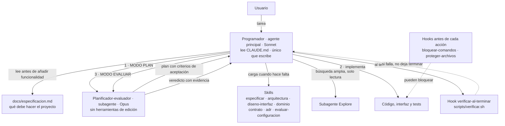

# Ingeniería de agentes para programación

Este repositorio es una configuración de referencia para Claude Code. Su
objetivo es que un agente de programación produzca resultados correctos,
verificables y mantenibles con la menor complejidad posible.

La configuración no parte de preferencias, sino de lo que se sabe sobre cómo se
comportan los modelos de lenguaje cuando trabajan como agentes. Este documento
explica esa base teórica: qué limitaciones tienen los modelos, qué principios se
derivan de ellas y cómo se materializa cada principio en el repositorio.

Las afirmaciones remiten a la lista de [Referencias](#referencias). Se usan
sobre todo estudios y guías de 2026. Un trabajo anterior sobre modelos de
lenguaje solo se mantiene si la evidencia de 2026 va en la misma dirección; si
la contradice, se retira. Los clásicos de la ingeniería del software (Parnas,
Meyer, Shingo, Nygard) se citan como fundamentos de diseño, no como mediciones
de modelos. Lo que es
interpretación propia, y no conclusión de una fuente, se indica como tal.

## Índice

- [Organización básica de un proyecto](#organización-básica-de-un-proyecto)
- [1. Tres limitaciones de partida](#1-tres-limitaciones-de-partida)
  - [La atención es un recurso escaso](#la-atención-es-un-recurso-escaso)
  - [El cumplimiento se degrada con el tiempo](#el-cumplimiento-se-degrada-con-el-tiempo)
  - [Un modelo juzga mal su propio trabajo](#un-modelo-juzga-mal-su-propio-trabajo)
- [2. Principios](#2-principios)
  - [2.1 Contexto mínimo y relevante](#21-contexto-mínimo-y-relevante)
  - [2.2 Un solo agente escribe](#22-un-solo-agente-escribe)
  - [2.3 Un programador y un planificador-evaluador](#23-un-programador-y-un-planificador-evaluador)
  - [2.4 Verificación externa y ejecutable](#24-verificación-externa-y-ejecutable)
  - [2.5 Lo obligatorio se garantiza con mecanismos](#25-lo-obligatorio-se-garantiza-con-mecanismos)
  - [2.6 Interfaces explícitas](#26-interfaces-explícitas)
  - [2.7 La memoria vive en artefactos](#27-la-memoria-vive-en-artefactos)
  - [2.8 Medir antes de creer](#28-medir-antes-de-creer)
- [3. Cómo encajan las piezas](#3-cómo-encajan-las-piezas)
- [4. Límites de este enfoque](#4-límites-de-este-enfoque)
- [Uso](#uso)
  - [Requisitos](#requisitos)
  - [1. Copiar la configuración a tu proyecto](#1-copiar-la-configuración-a-tu-proyecto)
  - [2. Comprobar los hooks](#2-comprobar-los-hooks)
  - [3. Empezar a trabajar con Claude Code](#3-empezar-a-trabajar-con-claude-code)
- [Referencias](#referencias)
- [Autoevaluación](#autoevaluación)

---

## Organización básica de un proyecto

Un proyecto que usa esta configuración separa tres documentos. Cada uno tiene un
lector distinto, responde a una pregunta distinta y se lee en un momento
distinto:

| Archivo | Para quién | Responde a | Cuándo se lee | Ejemplo: web para mostrar simuladores |
|---|---|---|---|---|
| `README.md` | Personas que llegan al repositorio | Qué es esto y cómo lo pongo en marcha | Cuando alguien abre el repositorio | "Web que muestra los simuladores del centro. Para ejecutarla: `npm install` y `npm run dev`." |
| `docs/especificacion.md` | Tú y el agente, al construir | Qué debe hacer exactamente | Antes de cada tarea que añada o cambie funcionalidad | "F1. Catálogo: muestra los simuladores publicados. Criterio: si no hay ninguno, aparece un mensaje en lugar de una lista vacía." |
| `CLAUDE.md` | El agente | Cómo se trabaja en este repositorio | Al empezar cada sesión, de forma automática | "Para verificar, ejecuta `scripts/verificar.sh`. No uses librerías de componentes externas." |

**Por qué separarlos:**

- **Nivel de detalle.** El README presenta el proyecto en pocas líneas. La
  especificación baja a cada funcionalidad, con sus criterios de aceptación, lo
  que queda fuera y las preguntas abiertas.
- **Uso.** Los criterios de la especificación son los que se usan para
  comprobar si una tarea está bien hecha (sección 2.4). Un texto de presentación
  no sirve para eso.
- **Coste.** `CLAUDE.md` se carga en cada sesión, así que debe ser breve. La
  especificación y el README solo se leen cuando hacen falta (sección 2.1).
- **Ritmo de cambio.** La especificación crece con cada funcionalidad; el README
  apenas cambia; `CLAUDE.md` cambia solo cuando cambia la forma de trabajar.

Lo único que comparten es el objetivo: el primer párrafo del README puede ser un
resumen del apartado "Objetivo" de la especificación. Lo natural es escribir
primero la especificación y sacar de ella esas líneas.

*Sobre el nombre de `CLAUDE.md`:* Claude Code carga ese archivo porque la
herramienta está programada para buscarlo, no porque el modelo esté entrenado
para ello. Si se prefiere un nombre independiente de la herramienta, existe el
formato abierto `AGENTS.md`, que reconocen otros agentes de programación [9]; en
ese caso `CLAUDE.md` puede contener solo la línea `@AGENTS.md` para importarlo
[12].

**Mapa de archivos:**

```
proyecto/
├── README.md                    Presentación del proyecto, para personas
├── CLAUDE.md                    Cómo se trabaja; se carga en cada sesión
├── docs/
│   ├── especificacion.md        Qué debe hacer el proyecto
│   └── adr/                     Por qué está construido así (decisiones)
├── .claude/
│   ├── agents/                  planificador-evaluador: planifica y evalúa
│   ├── skills/                  Conocimiento que se carga cuando hace falta
│   ├── hooks/                   Reglas que se cumplen siempre
│   └── settings.json            Registro de hooks y permisos
└── scripts/verificar.sh         Build, lint, tipos y tests en un comando
```

En este repositorio el README explica teoría porque el repositorio es la propia
configuración. En un proyecto que la use, el README presenta ese proyecto.

---

## 1. Tres limitaciones de partida

Todo el diseño responde a tres limitaciones bien documentadas de los modelos de
lenguaje.

### La atención es un recurso escaso

Un modelo no usa igual de bien toda la información que recibe. Su rendimiento
cae cuando el dato relevante está en medio de un contexto largo, y empeora a
medida que el contexto crece [1]. Anthropic llama a este fenómeno *context rot*
y propone tratar el contexto como un recurso finito con rendimientos
decrecientes: cada token adicional aporta menos que el anterior [2].

Los estudios de 2026 lo confirman en agentes. En LOCA-bench, el rendimiento de
los agentes cae a medida que crece el estado del entorno, y las técnicas de
gestión del contexto mejoran sustancialmente la tasa de éxito [33]. Un estudio
sobre modelos que vigilan transcripciones de agentes de programación encontró
que acciones peligrosas que detectaban en transcripciones cortas se les
escapaban cuando estaban enterradas en medio de una transcripción larga [3].
Anthropic, por su parte, observa que con más de 30 a 50 herramientas definidas
en el prompt de sistema el agente empieza a elegir peor cuál usar [13].

### El cumplimiento se degrada con el tiempo

Que una instrucción esté escrita no garantiza que se cumpla durante toda la
tarea. En un estudio de 2026 con más de 16.000 observaciones, el factor que más
afectaba al cumplimiento de una instrucción no era la longitud del archivo que la
contenía ni su posición, sino el avance de la sesión: cada función generada
reducía alrededor de un 5,6 % la probabilidad de cumplirla [4].

### Un modelo juzga mal su propio trabajo

Sin una señal externa, los modelos tienen dificultades para corregir su propio
razonamiento y a veces empeoran al intentarlo [5]. Cuando evalúan, tienden a
puntuar mejor sus propios textos que otros de calidad equivalente [6]. En
programación, Anthropic observó en 2026 que los agentes que desarrollan
aplicaciones durante horas elogian con seguridad su trabajo aunque sea
mediocre [7].

Estas tres limitaciones explican los principios que siguen: dar al agente poco
contexto y muy relevante, no confiar lo importante a instrucciones escritas y no
dejar que el agente valide su propio trabajo.

---

## 2. Principios

### 2.1 Contexto mínimo y relevante

Los archivos de instrucciones como `CLAUDE.md` o `AGENTS.md` se han convertido
en el mecanismo dominante para configurar agentes de programación, y a menudo en
el único [8][9]. Sin embargo, la evidencia sobre su utilidad es matizada.

Gloaguen et al. evaluaron cuatro agentes y concluyeron que estos archivos no
mejoran en general la tasa de tareas resueltas y aumentan el coste de inferencia
en más de un 20 % [10]. Los agentes sí siguen sus instrucciones, pero los
resúmenes del repositorio, aunque populares, no ayudan: el agente descubre la
estructura leyendo el código. Su recomendación es usar estos archivos para
indicar prácticas no estándar y evaluar cualquier supuesta mejora antes de
adoptarla [10]. Otro estudio del mismo año encontró, en cambio, que un AGENTS.md
reducía un 28,64 % el tiempo mediano y un 16,58 % los tokens de salida, sin
cambiar la tasa de finalización [11].

La conclusión práctica es que el archivo de instrucciones debe contener solo lo
que el agente no deduciría por sí mismo. La documentación de Claude Code
recomienda además no superar 200 líneas, y recuerda que su contenido es
contexto, no una configuración que el modelo esté obligado a respetar [12].

El conocimiento especializado que solo hace falta a veces se resuelve con
*skills*: paquetes de instrucciones de los que el agente ve primero una
descripción breve y carga el contenido completo solo cuando lo necesita [13].
Así el agente puede disponer de mucho conocimiento sin que ocupe contexto
mientras no lo usa.

**En el repositorio.** `CLAUDE.md` contiene solo comandos, convenciones no
estándar, trampas conocidas y las reglas de trabajo y de cierre. El conocimiento
especializado está en skills: `arquitectura`, `diseno-interfaz`, `dominio`,
`contrato` y `adr`.

### 2.2 Un solo agente escribe

Anthropic recomienda empezar por la solución más simple y añadir complejidad
solo cuando haga falta [14]. En 2026 fue más explícita: los sistemas
multiagente se aplican a menudo donde un solo agente funcionaría mejor, consumen
entre 3 y 10 veces más tokens para la misma tarea, y solo compensan cuando la
contaminación del contexto degrada el rendimiento, cuando el trabajo puede
hacerse en paralelo o cuando la especialización mejora el uso de herramientas
[15].

El tipo de trabajo es decisivo. En investigación, donde varios agentes leen
fuentes independientes, el sistema multiagente de Anthropic superó en un 90,2 %
a un único agente [16]. En programación ocurre lo contrario cuando varios
agentes escriben: en CooperBench, dos agentes que implementaban funcionalidades
distintas de un mismo repositorio lograron de media un 30 % menos de éxito que
un solo agente haciendo ambas. Fallaban por mensajes vagos o inexactos,
compromisos incumplidos y suposiciones erróneas sobre el plan del otro [17].

Cognition, que en 2025 desaconsejaba los sistemas multiagente porque las
decisiones quedaban dispersas [18], precisó en 2026 qué clase sí funciona:
varios agentes pueden aportar análisis, pero las escrituras deben seguir en un
solo hilo [19]. La taxonomía MAST, con 14 modos de fallo, documenta por qué estos
sistemas suelen mejorar poco o nada sobre un solo agente [20].

**En el repositorio.** Un único agente principal hace el trabajo de principio a
fin y es el único que modifica archivos.

### 2.3 Un programador y un planificador-evaluador

Un subagente es una instancia del modelo con su propia ventana de contexto, su
propio prompt y sus propias herramientas [21]. Cómo repartir el trabajo entre
agentes es la decisión más discutida de este diseño, y la evidencia tira en dos
direcciones.

**En contra de repartir por roles.** Anthropic advierte que repartir el trabajo
como en un equipo humano (planificador, implementador, tester, revisor) produce
un "teléfono roto": la información se degrada en cada traspaso [15]. En 2026
informó de despliegues que mejoraron al integrar planificadores y subagentes de
dominio en un solo agente con skills [13], y CooperBench muestra que dos agentes
que escriben a la vez rinden peor que uno solo [17].

**A favor de separar planificación y evaluación de la ejecución.** La propia
Anthropic, en su trabajo de 2026 sobre aplicaciones desarrolladas durante horas,
usó una arquitectura de tres agentes: planificador, generador y evaluador [7].
Su patrón *advisor* va en la misma línea: un modelo económico (Sonnet o Haiku)
ejecuta la tarea de principio a fin y consulta a Opus en las decisiones
difíciles; en sus evaluaciones mejoró los resultados de Sonnet solo con un coste
por tarea menor [31]. Fuera de Anthropic, Aider obtuvo el mejor resultado de su
benchmark de edición separando un modelo "arquitecto", que razona la solución,
de un modelo "editor", que escribe el código [32].

**Cómo se concilian.** Las fronteras que Anthropic considera válidas incluyen la
verificación de caja negra [15], y lo que se degrada en los traspasos es sobre
todo el contexto de implementación. De ahí cuatro decisiones:

- **El programador es el agente principal.** Conversa con el usuario, conserva
  todo el contexto de la implementación y es el único que escribe (código,
  interfaz y tests). Las escrituras siguen en un solo hilo [19].
- **El planificador-evaluador es un subagente sin herramientas de edición.**
  Planifica antes de implementar y evalúa al terminar. No puede escribir, así
  que no compite con el programador ni puede "arreglar" lo que evalúa.
- **Los traspasos son artefactos con formato fijo**, no conversación libre: el
  plan (archivos, pasos, contratos, criterios de aceptación comprobables) y el
  veredicto (criterios con evidencia, defectos, desviaciones del plan).
- **Cada modelo donde más rinde.** Opus, el modelo de más capacidad, razona el
  plan y juzga el resultado; Sonnet, más económico, hace la mayor parte del
  trabajo en tokens, que es implementar. Es el reparto del patrón *advisor* [31].

*Limitación:* no hay estudios que comparen directamente este esquema con un solo
agente o con un planificador y un programador como subagentes. Anthropic
recomienda evaluar con tareas propias tres variantes: el modelo económico solo,
el modelo económico con Opus como asesor y Opus solo [31]. El skill
`evaluar-configuracion` lo contempla (sección 2.8).

**En el repositorio.** La sesión principal usa Sonnet (`"model": "sonnet"` en
`.claude/settings.json`) y es el programador. El subagente
`planificador-evaluador` usa Opus y solo tiene herramientas de lectura,
búsqueda y ejecución de comandos. Para búsquedas amplias se usa `Explore`,
incluido en Claude Code [21]. El conocimiento especializado (arquitectura,
interfaz, dominio, contratos) sigue en skills que carga el programador [13].

### 2.4 Verificación externa y ejecutable

Si un modelo juzga mal su propio trabajo (sección 1), la evaluación tiene que
venir de fuera. Anthropic comprobó que separar un agente evaluador del que
genera es mucho más tratable que hacer autocrítico al generador, aunque el
evaluador sigue siendo indulgente si no tiene criterios concretos [7]. Para que
una verificación funcione recomienda darle criterios específicos en lugar de
objetivos vagos, pedirle casos límite y pruebas negativas, y exigirle la batería
completa, porque los verificadores suelen detenerse tras unos pocos tests
superados [15]. La verificación es además una buena frontera de contexto: apenas
necesita saber cómo se hizo el trabajo, solo qué debe cumplir [15].

La señal externa más fiable es la que se ejecuta. La guía de Claude Code
considera que dar al modelo una forma de comprobar su trabajo (tests, capturas,
salidas esperadas) es lo que más mejora los resultados [22].

**En el repositorio.** `scripts/verificar.sh` reúne build, lint, tipos y tests
en un solo comando. En modo EVALUAR, `planificador-evaluador` compara el diff
con el plan, ejecuta la batería completa, comprueba cada criterio de aceptación
con evidencia, prueba casos negativos y revisa que los tests no se hayan
debilitado. El evaluador no ha escrito el código y además es otro modelo.
*Interpretación propia:* esto debería reducir el sesgo de autopreferencia [6],
que está ligado a que el modelo reconozca sus propios textos.

### 2.5 Lo obligatorio se garantiza con mecanismos

Una instrucción escrita depende de que el modelo la recuerde, y su cumplimiento
cae con el avance de la sesión [4]. Los *hooks* de Claude Code resuelven esto:
son programas que se ejecutan automáticamente en momentos concretos (antes de
usar una herramienta, al terminar una respuesta) y que garantizan que ciertas
acciones ocurran siempre, sin depender de que el modelo decida hacerlas [23].
Un hook bloquea una acción saliendo con código 2: Claude Code descarta la acción
y le pasa a Claude el mensaje escrito en la salida de error. Cualquier otro
código de error se trata como no bloqueante y la acción sigue adelante [30].

La idea es antigua. Shingo desarrolló en la industria los dispositivos
*poka-yoke*, que impiden cometer un error o lo hacen evidente al instante, y la
inspección en la fuente, que comprueba las condiciones antes de producir en lugar
de buscar defectos después [24][25]. En programación, Minsky la formuló como
"hacer irrepresentables los estados ilegales": modelar los datos para que lo
inválido no se pueda ni escribir [26]. De ahí un orden de preferencia ante
cualquier error relevante: rediseñar para que no pueda ocurrir, restringir con
tipos o validadores, automatizar su detección con un test o un hook y, solo como
último recurso, documentarlo.

**En el repositorio.** Tres hooks actúan como enclavamientos:

| Hook | Momento | Función |
|---|---|---|
| `bloquear-comandos.py` | Antes de cada comando | Bloquea comandos destructivos o irreversibles (borrados recursivos, `git push --force`, `reset --hard`, `DROP TABLE`, `DELETE` sin `WHERE`...) y pide autorización |
| `proteger-archivos.py` | Antes de cada edición | Impide modificar secretos y la propia configuración de seguridad, para que el agente no pueda desactivarla |
| `verificar-al-terminar.py` | Al terminar | Si hay cambios y `scripts/verificar.sh` falla, impide dar la tarea por terminada; no vuelve a bloquear si ya lo hizo, para evitar bucles |

`.claude/settings.json` registra estos hooks y deniega además la lectura de
archivos de secretos.

### 2.6 Interfaces explícitas

El *diseño por contrato* de Meyer concibe cada componente como la implementación
de una especificación con obligaciones y beneficios explícitos para quien lo usa
y para quien lo implementa [27]. Parnas propuso dividir un sistema según qué
decisión de diseño oculta cada módulo, de modo que una implementación pueda
sustituirse sin afectar a las demás [28].

Para un agente estas ideas tienen un valor añadido. Las interfaces limpias son
una de las fronteras válidas para dividir trabajo [15], y buena parte de los
fallos observados en CooperBench son suposiciones erróneas sobre lo que hace la
otra parte [17]. *Interpretación propia:* un contrato ejecutable (tipos,
esquemas, tests de contrato) sustituye esas suposiciones por algo comprobable,
también entre sesiones distintas del mismo agente.

**En el repositorio.** El skill `contrato` define cómo expresar una interfaz de
forma ejecutable y cómo cambiarla sin romper a quien depende de ella. El skill
`arquitectura` aplica el criterio de Parnas a las decisiones estructurales.

### 2.7 La memoria vive en artefactos

Un agente empieza cada sesión sin recordar las anteriores. Nygard propuso en 2011
los *Architecture Decision Records*: documentos breves, guardados en el
repositorio, que recogen el contexto, la decisión, su estado y sus consecuencias
[29]. En 2026, Anthropic señaló el uso de artefactos estructurados para traspasar
el contexto entre sesiones como una de las claves de sus agentes de programación
de larga duración [7].

Conviene distinguir tres tipos de memoria, porque cada una responde a una
pregunta distinta: qué debe hacer el proyecto (la especificación), por qué está
construido así (los ADR) y cómo se trabaja en él (`CLAUDE.md`). La sección
[Organización básica](#organización-básica-de-un-proyecto) detalla cómo se
reparten.

La especificación cumple el papel que en la ingeniería de requisitos clásica
tienen los requisitos con criterios de aceptación. El propio trabajo de
Anthropic de 2026 sobre aplicaciones de larga duración usa un agente planificador
previo al que genera el código [7]. *Interpretación propia:* sus criterios de
aceptación son además los que usa el planificador-evaluador (sección 2.4), y
mantenerla fuera de `CLAUDE.md` evita cargar en cada sesión un texto largo que
solo hace falta en algunas tareas (sección 2.1).

**En el repositorio.** El skill `especificar` convierte la idea del usuario en
`docs/especificacion.md`, con funcionalidades, criterios de aceptación
comprobables y lo que queda fuera de alcance; `CLAUDE.md` solo indica dónde
está y cuándo leerla. El skill `adr` registra las decisiones significativas, y
`CLAUDE.md` pide una nota de traspaso al final de cada sesión en las tareas
largas. *Interpretación propia:* esto también compensa la caída del cumplimiento
durante la sesión [4], porque permite empezar de nuevo sin perder el estado.

### 2.8 Medir antes de creer

Los estudios sobre configuración de agentes no siempre coinciden ([10] frente a
[11]) y miden proyectos, tareas y modelos distintos. Tanto Gloaguen et al. como
Anthropic recomiendan evaluar cada cambio con tareas propias antes de adoptarlo
[10][13]. Una regla en `CLAUDE.md`, un skill o un subagente es una hipótesis hasta
que se mide.

**En el repositorio.** El skill `evaluar-configuracion` compara tareas reales ya
resueltas con y sin un cambio, repitiendo cada ejecución, y mide éxito, tokens,
tiempo y falsos "terminado".

---

## 3. Cómo encajan las piezas



El programador (agente principal, Sonnet) recibe la tarea con un contexto
mínimo y consulta la especificación cuando la tarea afecta a lo que hace el
proyecto. Antes de implementar, pide un plan al planificador-evaluador (Opus),
que devuelve los pasos y los criterios de aceptación. Implementa con el
conocimiento de los skills que necesite, dentro de los límites que fijan los
hooks, y es el único que modifica archivos. Al terminar, el
planificador-evaluador comprueba el resultado contra el plan y sus criterios, y
el hook de cierre exige que la verificación completa pase.

| Componente | Principio que aplica |
|---|---|
| `CLAUDE.md` | Contexto mínimo y relevante (2.1) |
| `.claude/skills/` | Contexto bajo demanda (2.1), interfaces explícitas (2.6), memoria (2.7), medición (2.8) |
| `docs/especificacion.md` | Memoria en artefactos (2.7); fuente de los criterios de aceptación (2.4) |
| `.claude/agents/planificador-evaluador.md` | Planificación y evaluación separadas de la ejecución (2.3), verificación externa (2.4) |
| `.claude/hooks/` y `.claude/settings.json` | Lo obligatorio con mecanismos (2.5) |
| `scripts/verificar.sh` | Verificación ejecutable (2.4) |
| `docs/autoevaluacion.html` | Test de autoevaluación sobre esta teoría |

---

## 4. Límites de este enfoque

- La evidencia sobre archivos de instrucciones es reciente y en parte
  contradictoria [10][11][4], porque cada estudio usa tareas y modelos distintos.
- Las guías de Anthropic de 2026 [13][15] se basan en su experiencia con clientes
  y en mediciones puntuales, no en estudios controlados publicados.
- CooperBench [17] mide agentes que escriben en paralelo, no un programador
  acompañado de un planificador-evaluador de solo lectura, que es el esquema que
  se usa aquí.
- El reparto de modelos (Opus planifica y evalúa, Sonnet programa) se apoya en
  el patrón *advisor* [31] y en Aider [32], pero ninguno de los dos mide
  exactamente este esquema en Claude Code. El plan que entrega el subagente es un
  traspaso de contexto y puede perder información; el formato fijo del plan
  intenta reducirlo, pero no se ha medido.
- Los hooks reducen riesgos, pero `bloquear-comandos.py` se basa en patrones de
  texto y un comando ofuscado puede saltárselo. No sustituyen a los permisos ni a
  las copias de seguridad.
- Esta configuración no se ha evaluado todavía con tareas reales mediante el
  skill `evaluar-configuracion`.

---

## Uso

### Requisitos

- Claude Code.
- Python 3.8 o superior, para los hooks.
- Git. El proyecto debe ser un repositorio git, porque el hook de cierre usa
  `git status` para saber si hay cambios.
- En Windows, **Git for Windows**: Claude Code ejecuta los hooks con Git Bash.
  Los hooks se lanzan con `.claude/hooks/ejecutar.sh`, que busca el Python que
  funcione (`python3`, `python` o `py`); en Windows, `python3` suele ser un
  alias de Microsoft Store que no ejecuta nada.

### 1. Copiar la configuración a tu proyecto

Desde la raíz de tu proyecto. Ninguno de los comandos sobrescribe archivos que
ya existan: si tu proyecto ya tenía `CLAUDE.md` o `.claude/settings.json`,
fusiónalos a mano.

**Windows (PowerShell)**

```powershell
$tmp = "$env:TEMP\ingenieria-agentes"
git clone --depth 1 https://github.com/AlvarLegaz/ingenieria-agentes.git $tmp
robocopy "$tmp\.claude" .claude /E /XC /XN /XO
robocopy "$tmp\scripts" scripts /E /XC /XN /XO
robocopy "$tmp\docs" docs especificacion.md /XC /XN /XO
foreach ($f in "CLAUDE.md", ".gitattributes") { if (-not (Test-Path $f)) { Copy-Item "$tmp\$f" . } }
Remove-Item -Recurse -Force $tmp
if (-not (Test-Path .git)) { git init }
```

`robocopy` con `/XC /XN /XO` copia solo los archivos que no existen en el
destino.

**Linux, macOS o WSL**

```bash
tmp=/tmp/ingenieria-agentes
git clone --depth 1 https://github.com/AlvarLegaz/ingenieria-agentes.git "$tmp"
cp -Rn "$tmp/.claude" "$tmp/scripts" .
mkdir -p docs && cp -n "$tmp/docs/especificacion.md" docs/
cp -n "$tmp/CLAUDE.md" "$tmp/.gitattributes" .
rm -rf "$tmp"
[ -d .git ] || git init
```

En versiones recientes de Linux, `cp -n` muestra un aviso de portabilidad que es
inofensivo.

### 2. Comprobar los hooks

**Windows (PowerShell)**

```powershell
python --version
# Debe mostrar el motivo del bloqueo y "exit 2"
'{"tool_input":{"command":"git push --force"}}' | python .claude\hooks\bloquear-comandos.py; "exit $LASTEXITCODE"
# Debe mostrar "exit 0"
'{"tool_input":{"command":"git status"}}' | python .claude\hooks\bloquear-comandos.py; "exit $LASTEXITCODE"
```

**Linux, macOS o WSL**

```bash
echo '{"tool_input":{"command":"git push --force"}}' | bash .claude/hooks/ejecutar.sh bloquear-comandos.py; echo "exit $?"
echo '{"tool_input":{"command":"git status"}}' | bash .claude/hooks/ejecutar.sh bloquear-comandos.py; echo "exit $?"
```

### 3. Empezar a trabajar con Claude Code

Abre `claude` en la carpeta del proyecto y sigue este orden:

| Paso | Qué escribir | Qué ocurre |
|---|---|---|
| 1 | `/inicializar-proyecto` | Detecta el stack, rellena `CLAUDE.md` y `scripts/verificar.sh` y, si la especificación está vacía, te pregunta qué quieres construir |
| 2 | Tu idea, con tus palabras | El skill `especificar` la convierte en `docs/especificacion.md`, con funcionalidades y criterios de aceptación |
| 3 | Revisa la especificación y corrígela | Es tu documento: nada se implementa hasta que lo apruebes |
| 4 | `/agents` y `/hooks` | Comprobar que aparece `planificador-evaluador` y que los tres hooks están registrados |
| 5 | Una tarea concreta, por ejemplo: "Implementa F1 de la especificación" | El programador pide un plan al `planificador-evaluador`, implementa, ejecuta `scripts/verificar.sh` y pide la evaluación final |

Los skills también se activan si los pides con palabras ("inicializa el
proyecto", "ayúdame a especificar lo que quiero construir").

---

## Referencias

1. Liu, N. F., Lin, K., Hewitt, J., Paranjape, A., Bevilacqua, M., Petroni, F. y
   Liang, P. (2023). *Lost in the Middle: How Language Models Use Long
   Contexts*. arXiv:2307.03172. <https://arxiv.org/abs/2307.03172>
2. Anthropic (2025). *Effective context engineering for AI agents*.
   <https://www.anthropic.com/engineering/effective-context-engineering-for-ai-agents>
3. *Classifier Context Rot: Monitor Performance Degrades with Context Length*
   (2026, mayo). arXiv:2605.12366. <https://arxiv.org/abs/2605.12366>
4. McMillan, D. (2026). *Instruction Adherence in Coding Agent Configuration
   Files: A Factorial Study of Four File-Structure Variables*.
   arXiv:2605.10039. <https://arxiv.org/abs/2605.10039>
5. Huang, J., Chen, X., Mishra, S., Zheng, H. S., Yu, A. W., Song, X. y Zhou, D.
   (2024). *Large Language Models Cannot Self-Correct Reasoning Yet*. ICLR 2024.
   arXiv:2310.01798. <https://arxiv.org/abs/2310.01798>
6. Panickssery, A., Bowman, S. R. y Feng, S. (2024). *LLM Evaluators Recognize
   and Favor Their Own Generations*. NeurIPS 2024. arXiv:2404.13076.
   <https://arxiv.org/abs/2404.13076>
7. Rajasekaran, P. / Anthropic (2026, 24 de marzo). *Harness design for
   long-running application development*.
   <https://www.anthropic.com/engineering/harness-design-long-running-apps>
8. *Agent READMEs: An Empirical Study of Context Files for Agentic Coding*
   (v2, 9 de agosto de 2026). arXiv:2511.12884.
   <https://arxiv.org/abs/2511.12884>
9. *Configuring Agentic AI Coding Tools: An Exploratory Study* (2026).
   arXiv:2602.14690. <https://arxiv.org/abs/2602.14690>
10. Gloaguen, T., Mündler-Sasahara, N., Müller, M. N., Raychev, V. y Vechev, M.
    (2026). *Evaluating AGENTS.md: Are Repository-Level Context Files Helpful for
    Coding Agents?* arXiv:2602.11988. <https://arxiv.org/abs/2602.11988>
11. Lulla, J. L., Mohsenimofidi, S., Galster, M., Zhang, J. M., Baltes, S. y
    Treude, C. (2026). *On the Impact of AGENTS.md Files on the Efficiency of AI
    Coding Agents*. arXiv:2601.20404. <https://arxiv.org/abs/2601.20404>
12. Anthropic. *How Claude remembers your project* (documentación de Claude
    Code). <https://code.claude.com/docs/en/memory>
13. Sarkis, D. / Anthropic Applied AI (2026, 22 de octubre). *Building agents:
    When to fold subagents into your main agent loop*.
    <https://claude.com/resources/articles/building-agents-when-to-fold-subagents-into-your-main-agent-loop>
14. Anthropic (2024, 19 de diciembre). *Building effective agents*.
    <https://www.anthropic.com/engineering/building-effective-agents>
15. Anthropic (2026, 23 de enero). *Building multi-agent systems: When and how
    to use them*.
    <https://claude.com/blog/building-multi-agent-systems-when-and-how-to-use-them>
16. Anthropic (2025, junio). *How we built our multi-agent research system*.
    <https://www.anthropic.com/engineering/multi-agent-research-system>
17. Khatua, A., Zhu, H., Tran, P. et al. y Yang, D. (2026). *CooperBench: Why
    Coding Agents Cannot be Your Teammates Yet*. arXiv:2601.13295.
    <https://arxiv.org/abs/2601.13295>
18. Yan, W. (2025, 12 de junio). *Don't Build Multi-Agents*. Cognition.
    <https://cognition.ai/blog/dont-build-multi-agents>
19. Yan, W. (2026, 22 de abril). *Multi-Agents: What's Actually Working*.
    Cognition. <https://cognition.ai/blog/multi-agents-working>
20. Cemri, M., Pan, M. Z., Yang, S. et al. (2025). *Why Do Multi-Agent LLM
    Systems Fail?* arXiv:2503.13657. <https://arxiv.org/abs/2503.13657>
21. Anthropic. *Create custom subagents* (documentación de Claude Code).
    <https://code.claude.com/docs/en/sub-agents>
22. Anthropic. *Best practices for Claude Code* (documentación de Claude Code).
    <https://code.claude.com/docs/en/best-practices>
23. Anthropic. *Automate workflows with hooks* (documentación de Claude Code).
    <https://code.claude.com/docs/en/hooks-guide>
24. Shingo, S. (1986). *Zero Quality Control: Source Inspection and the
    Poka-Yoke System*. Routledge. ISBN 9780915299072.
25. Grout, J. R. y Downs, B. T. *A Brief Tutorial on Mistake-proofing,
    Poka-Yoke, and ZQC*.
    <https://mistakeproofing.com/a-brief-tutorial-on-mistake-proofing-poka-yoke-and-zqc/>
26. Minsky, Y. (2010). *Effective ML*. Conferencia en Harvard. Desarrollo del
    principio: Wlaschin, S. *Designing with types: Making illegal states
    unrepresentable*.
    <https://fsharpforfunandprofit.com/posts/designing-with-types-making-illegal-states-unrepresentable/>
27. Meyer, B. (1992). Applying "Design by Contract". *IEEE Computer*, 25(10),
    40–51. <https://doi.org/10.1109/2.161279>
28. Parnas, D. L. (1972). On the Criteria To Be Used in Decomposing Systems into
    Modules. *Communications of the ACM*, 15(12), 1053–1058.
    <https://doi.org/10.1145/361598.361623>
29. Nygard, M. (2011, 15 de noviembre). *Documenting Architecture Decisions*.
    Cognitect.
    <https://cognitect.com/blog/2011/11/15/documenting-architecture-decisions>
30. Anthropic. *Hooks reference* (documentación de Claude Code).
    <https://code.claude.com/docs/en/hooks>
31. Anthropic (2026, 9 de abril). *The advisor strategy: Give agents an
    intelligence boost*. <https://claude.com/blog/the-advisor-strategy>
32. Aider (2024, 26 de septiembre). *Separating code reasoning and editing*.
    <https://aider.chat/2024/09/26/architect.html>
33. Zeng, W. et al. (2026, febrero). *LOCA-bench: Benchmarking Language Agents
    Under Controllable and Extreme Context Growth*. arXiv:2602.07962.
    <https://arxiv.org/abs/2602.07962>
34. Anthropic. *Referencia de herramientas* (documentación de Claude Code).
    <https://code.claude.com/docs/en/tools-reference>
35. Model Context Protocol (2026). *Specification: Tools*.
    <https://modelcontextprotocol.io/specification/2026-07-28/server/tools>
36. AGENTS.md. *Formato abierto de instrucciones para agentes de programación*.
    <https://agents.md>
37. Git. *git-diff* (documentación oficial). <https://git-scm.com/docs/git-diff>
38. OpenAI. *Subagents* (documentación de Codex).
    <https://developers.openai.com/codex/subagents>

---

## Autoevaluación

Test interactivo de 132 preguntas para aprender los conceptos de este documento:

**▶ [Hacer la autoevaluación](https://alvarlegaz.github.io/ingenieria-agentes/autoevaluacion.html)**

Las preguntas evalúan conceptos y su aplicación, no lo que dijo un estudio
concreto: las fuentes aparecen en la explicación de cada respuesta, con la misma
numeración que la lista de referencias. Se agrupan en diez bloques:

- **Introducción**: qué es un modelo, qué es un agente y qué es el arnés, cómo
  se definen los agentes en Claude Code o Codex,
  contexto, tokens, archivos de instrucciones, subagentes, skills y hooks,
  explicados de forma general para cualquier herramienta de agentes.
- **Herramientas**: las herramientas típicas de un agente de programación (Read,
  Write, Edit, Glob, Grep, Bash, WebSearch, WebFetch, subagentes, lista de
  tareas, LSP, MCP…), qué hace cada una y cuándo elegirla.
- Siete bloques de teoría: contexto y `CLAUDE.md`, uno o varios agentes,
  subagentes, verificación, prevención de errores, contratos, y memoria y
  medición.
- **Casos prácticos con código**: fragmentos reales (definiciones de
  subagentes, hooks, `settings.json`, tipos y esquemas, secciones de
  `CLAUDE.md` y de especificaciones) en los que hay que detectar el fallo o
  elegir la mejor versión.

Al terminar muestra la nota por bloque y permite repasar solo las preguntas
falladas.

El test está en `docs/autoevaluacion.html` y también funciona sin conexión:
descárgalo y ábrelo con el navegador.
