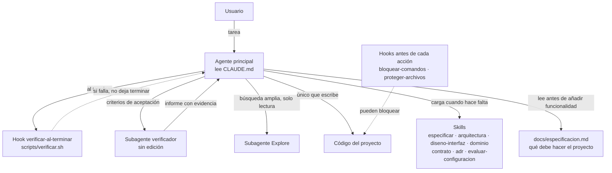

# Ingeniería de agentes para programación

Este repositorio es una configuración de referencia para Claude Code. Su
objetivo es que un agente de programación produzca resultados correctos,
verificables y mantenibles con la menor complejidad posible.

La configuración no parte de preferencias, sino de lo que se sabe sobre cómo se
comportan los modelos de lenguaje cuando trabajan como agentes. Este documento
explica esa base teórica: qué limitaciones tienen los modelos, qué principios se
derivan de ellas y cómo se materializa cada principio en el repositorio.

Las afirmaciones remiten a la lista de [Referencias](#referencias). Se usan
sobre todo estudios y guías de 2026; los trabajos anteriores aparecen cuando
siguen siendo la referencia de un fenómeno, y los clásicos de la ingeniería del
software (Parnas, Meyer, Shingo, Nygard) como fundamentos. Lo que es
interpretación propia, y no conclusión de una fuente, se indica como tal.

---

## 1. Tres limitaciones de partida

Todo el diseño responde a tres limitaciones bien documentadas de los modelos de
lenguaje.

### La atención es un recurso escaso

Un modelo no usa igual de bien toda la información que recibe. Su rendimiento
cae cuando el dato relevante está en medio de un contexto largo, y empeora a
medida que el contexto crece [1]. Anthropic llama a este fenómeno *context rot*
y propone tratar el contexto como un recurso finito con rendimientos
decrecientes: cada token adicional aporta menos que el anterior [2]. Lo mismo
ocurre con las instrucciones: con cientos de ellas a la vez, incluso los mejores
modelos dejan de cumplir una parte importante, y favorecen las primeras [3].

### El cumplimiento se degrada con el tiempo

Que una instrucción esté escrita no garantiza que se cumpla durante toda la
tarea. En un estudio de 2026 con más de 16.000 observaciones, el factor que más
afectaba al cumplimiento de una instrucción no era la longitud del archivo que la
contenía ni su posición, sino el avance de la sesión: cada función generada
reducía alrededor de un 5,6 % la probabilidad de cumplirla [4].

### Un modelo juzga mal su propio trabajo

Sin una señal externa, los modelos tienen dificultades para corregir su propio
razonamiento y a veces empeoran al intentarlo [5]. Cuando evalúan, tienden a
puntuar mejor sus propios textos que otros de calidad equivalente [6]. En
programación, Anthropic observó en 2026 que los agentes que desarrollan
aplicaciones durante horas elogian con seguridad su trabajo aunque sea
mediocre [7].

Estas tres limitaciones explican los principios que siguen: dar al agente poco
contexto y muy relevante, no confiar lo importante a instrucciones escritas y no
dejar que el agente valide su propio trabajo.

---

## 2. Principios

### 2.1 Contexto mínimo y relevante

Los archivos de instrucciones como `CLAUDE.md` o `AGENTS.md` se han convertido
en el mecanismo dominante para configurar agentes de programación, y a menudo en
el único [8][9]. Sin embargo, la evidencia sobre su utilidad es matizada.

Gloaguen et al. evaluaron cuatro agentes y concluyeron que estos archivos no
mejoran en general la tasa de tareas resueltas y aumentan el coste de inferencia
en más de un 20 % [10]. Los agentes sí siguen sus instrucciones, pero los
resúmenes del repositorio, aunque populares, no ayudan: el agente descubre la
estructura leyendo el código. Su recomendación es usar estos archivos para
indicar prácticas no estándar y evaluar cualquier supuesta mejora antes de
adoptarla [10]. Otro estudio del mismo año encontró, en cambio, que un AGENTS.md
reducía un 28,64 % el tiempo mediano y un 16,58 % los tokens de salida, sin
cambiar la tasa de finalización [11].

La conclusión práctica es que el archivo de instrucciones debe contener solo lo
que el agente no deduciría por sí mismo. La documentación de Claude Code
recomienda además no superar 200 líneas, y recuerda que su contenido es
contexto, no una configuración que el modelo esté obligado a respetar [12].

El conocimiento especializado que solo hace falta a veces se resuelve con
*skills*: paquetes de instrucciones de los que el agente ve primero una
descripción breve y carga el contenido completo solo cuando lo necesita [13].
Así el agente puede disponer de mucho conocimiento sin que ocupe contexto
mientras no lo usa.

**En el repositorio.** `CLAUDE.md` contiene solo comandos, convenciones no
estándar, trampas conocidas y las reglas de trabajo y de cierre. El conocimiento
especializado está en skills: `arquitectura`, `diseno-interfaz`, `dominio`,
`contrato` y `adr`.

### 2.2 Un solo agente escribe

Anthropic recomienda empezar por la solución más simple y añadir complejidad
solo cuando haga falta [14]. En 2026 fue más explícita: los sistemas
multiagente se aplican a menudo donde un solo agente funcionaría mejor, consumen
entre 3 y 10 veces más tokens para la misma tarea, y solo compensan cuando la
contaminación del contexto degrada el rendimiento, cuando el trabajo puede
hacerse en paralelo o cuando la especialización mejora el uso de herramientas
[15].

El tipo de trabajo es decisivo. En investigación, donde varios agentes leen
fuentes independientes, el sistema multiagente de Anthropic superó en un 90,2 %
a un único agente [16]. En programación ocurre lo contrario cuando varios
agentes escriben: en CooperBench, dos agentes que implementaban funcionalidades
distintas de un mismo repositorio lograron de media un 30 % menos de éxito que
un solo agente haciendo ambas. Fallaban por mensajes vagos o inexactos,
compromisos incumplidos y suposiciones erróneas sobre el plan del otro [17].

Cognition, que en 2025 desaconsejaba los sistemas multiagente porque las
decisiones quedaban dispersas [18], precisó en 2026 qué clase sí funciona:
varios agentes pueden aportar análisis, pero las escrituras deben seguir en un
solo hilo [19]. La taxonomía MAST, con 14 modos de fallo, documenta por qué estos
sistemas suelen mejorar poco o nada sobre un solo agente [20].

**En el repositorio.** Un único agente principal hace el trabajo de principio a
fin y es el único que modifica archivos.

### 2.3 Separar contexto, no repartir roles

Un subagente es una instancia del modelo con su propia ventana de contexto, su
propio prompt y sus propias herramientas [21]. Su utilidad real es esa: aislar
un trabajo para que no llene el contexto del agente principal.

Anthropic distingue entre dividir por roles y dividir por contexto. Repartir el
trabajo como en un equipo humano (planificador, implementador, tester, revisor)
produce un "teléfono roto": la información se degrada en cada traspaso, y las
fases sucesivas de un mismo trabajo deberían quedarse en un solo agente [15].
Las fronteras adecuadas son otras: líneas de investigación independientes,
componentes con interfaces limpias y verificación de caja negra [15]. En la
misma línea, Anthropic informó en 2026 de despliegues que mejoraron al integrar
subagentes de planificación y de dominio en un solo agente con skills, uno de
ellos con una ejecución unas 2 veces más rápida [13]. Mantener un subagente se
justifica cuando hay una degradación medible por exceso de contexto, cuando
varias tareas necesitan contextos nuevos que se descartan al terminar, o cuando
un solo agente no acierta con las herramientas [13].

**En el repositorio.** Hay dos subagentes, y ambos separan contexto: `Explore`,
incluido en Claude Code, para búsquedas amplias de solo lectura [21], y
`verificador`, para la verificación independiente (sección 2.4).

### 2.4 Verificación externa y ejecutable

Si un modelo juzga mal su propio trabajo (sección 1), la verificación tiene que
venir de fuera. Anthropic comprobó que separar un agente evaluador del que
genera es mucho más tratable que hacer autocrítico al generador, aunque el
evaluador sigue siendo indulgente si no tiene criterios concretos [7]. Para que
un verificador funcione recomienda darle criterios específicos en lugar de
objetivos vagos, pedirle casos límite y pruebas negativas, y exigirle la batería
completa, porque los verificadores suelen detenerse tras unos pocos tests
superados [15]. La verificación es además una buena frontera de contexto: apenas
necesita saber cómo se hizo el trabajo, solo qué debe cumplir [15].

La señal externa más fiable es la que se ejecuta. La guía de Claude Code
considera que dar al modelo una forma de comprobar su trabajo (tests, capturas,
salidas esperadas) es lo que más mejora los resultados [22].

**En el repositorio.** `scripts/verificar.sh` reúne build, lint, tipos y tests
en un solo comando. El subagente `verificador` recibe criterios de aceptación,
ejecuta la batería completa, prueba casos negativos y devuelve evidencia. No
tiene herramientas de edición, de modo que no puede arreglar lo que verifica.

### 2.5 Lo obligatorio se garantiza con mecanismos

Una instrucción escrita depende de que el modelo la recuerde, y su cumplimiento
cae con el avance de la sesión [4]. Los *hooks* de Claude Code resuelven esto:
son programas que se ejecutan automáticamente en momentos concretos (antes de
usar una herramienta, al terminar una respuesta) y que garantizan que ciertas
acciones ocurran siempre, sin depender de que el modelo decida hacerlas [23].

La idea es antigua. Shingo desarrolló en la industria los dispositivos
*poka-yoke*, que impiden cometer un error o lo hacen evidente al instante, y la
inspección en la fuente, que comprueba las condiciones antes de producir en lugar
de buscar defectos después [24][25]. En programación, Minsky la formuló como
"hacer irrepresentables los estados ilegales": modelar los datos para que lo
inválido no se pueda ni escribir [26]. De ahí un orden de preferencia ante
cualquier error relevante: rediseñar para que no pueda ocurrir, restringir con
tipos o validadores, automatizar su detección con un test o un hook y, solo como
último recurso, documentarlo.

**En el repositorio.** Tres hooks actúan como enclavamientos:

| Hook | Momento | Función |
|---|---|---|
| `bloquear-comandos.py` | Antes de cada comando | Bloquea comandos destructivos o irreversibles (borrados recursivos, `git push --force`, `reset --hard`, `DROP TABLE`, `DELETE` sin `WHERE`...) y pide autorización |
| `proteger-archivos.py` | Antes de cada edición | Impide modificar secretos y la propia configuración de seguridad, para que el agente no pueda desactivarla |
| `verificar-al-terminar.py` | Al terminar | Si hay cambios y `scripts/verificar.sh` falla, impide dar la tarea por terminada; no vuelve a bloquear si ya lo hizo, para evitar bucles |

`.claude/settings.json` registra estos hooks y deniega además la lectura de
archivos de secretos.

### 2.6 Interfaces explícitas

El *diseño por contrato* de Meyer concibe cada componente como la implementación
de una especificación con obligaciones y beneficios explícitos para quien lo usa
y para quien lo implementa [27]. Parnas propuso dividir un sistema según qué
decisión de diseño oculta cada módulo, de modo que una implementación pueda
sustituirse sin afectar a las demás [28].

Para un agente estas ideas tienen un valor añadido. Las interfaces limpias son
una de las fronteras válidas para dividir trabajo [15], y buena parte de los
fallos observados en CooperBench son suposiciones erróneas sobre lo que hace la
otra parte [17]. *Interpretación propia:* un contrato ejecutable (tipos,
esquemas, tests de contrato) sustituye esas suposiciones por algo comprobable,
también entre sesiones distintas del mismo agente.

**En el repositorio.** El skill `contrato` define cómo expresar una interfaz de
forma ejecutable y cómo cambiarla sin romper a quien depende de ella. El skill
`arquitectura` aplica el criterio de Parnas a las decisiones estructurales.

### 2.7 La memoria vive en artefactos

Un agente empieza cada sesión sin recordar las anteriores. Nygard propuso en 2011
los *Architecture Decision Records*: documentos breves, guardados en el
repositorio, que recogen el contexto, la decisión, su estado y sus consecuencias
[29]. En 2026, Anthropic señaló el uso de artefactos estructurados para traspasar
el contexto entre sesiones como una de las claves de sus agentes de programación
de larga duración [7].

Conviene distinguir tres tipos de memoria, porque cada una responde a una
pregunta distinta y se lee en un momento distinto:

| Artefacto | Pregunta que responde | Cuándo se lee |
|---|---|---|
| Especificación (`docs/especificacion.md`) | Qué debe hacer el proyecto | Antes de tareas que añadan o cambien funcionalidad |
| ADR (`docs/adr/`) | Por qué está construido así | Antes de decisiones estructurales |
| `CLAUDE.md` | Cómo se trabaja en el repositorio | En cada sesión |

La especificación cumple el papel que en la ingeniería de requisitos clásica
tienen los requisitos con criterios de aceptación. El propio trabajo de
Anthropic de 2026 sobre aplicaciones de larga duración usa un agente planificador
previo al que genera el código [7]. *Interpretación propia:* sus criterios de
aceptación son además los que necesita el verificador (sección 2.4), y
mantenerla fuera de `CLAUDE.md` evita cargar en cada sesión un texto largo que
solo hace falta en algunas tareas (sección 2.1).

**En el repositorio.** El skill `especificar` convierte la idea del usuario en
`docs/especificacion.md`, con funcionalidades, criterios de aceptación
comprobables y lo que queda fuera de alcance; `CLAUDE.md` solo indica dónde
está y cuándo leerla. El skill `adr` registra las decisiones significativas, y
`CLAUDE.md` pide una nota de traspaso al final de cada sesión en las tareas
largas. *Interpretación propia:* esto también compensa la caída del cumplimiento
durante la sesión [4], porque permite empezar de nuevo sin perder el estado.

### 2.8 Medir antes de creer

Los estudios sobre configuración de agentes no siempre coinciden ([10] frente a
[11]) y miden proyectos, tareas y modelos distintos. Tanto Gloaguen et al. como
Anthropic recomiendan evaluar cada cambio con tareas propias antes de adoptarlo
[10][13]. Una regla en `CLAUDE.md`, un skill o un subagente es una hipótesis hasta
que se mide.

**En el repositorio.** El skill `evaluar-configuracion` compara tareas reales ya
resueltas con y sin un cambio, repitiendo cada ejecución, y mide éxito, tokens,
tiempo y falsos "terminado".

---

## 3. Cómo encajan las piezas



El agente principal recibe la tarea con un contexto mínimo, consulta la
especificación cuando la tarea afecta a lo que hace el proyecto y carga el
conocimiento especializado solo cuando lo necesita. Delega en subagentes
únicamente lo que conviene aislar: búsquedas que llenarían su contexto y la
verificación, que debe ser independiente. Es el único que modifica el código, y
lo hace dentro de los límites que fijan los hooks. Antes de terminar, el
verificador comprueba el trabajo contra criterios concretos y el hook de cierre
exige que la verificación completa pase.

| Componente | Principio que aplica |
|---|---|
| `CLAUDE.md` | Contexto mínimo y relevante (2.1) |
| `.claude/skills/` | Contexto bajo demanda (2.1), interfaces explícitas (2.6), memoria (2.7), medición (2.8) |
| `docs/especificacion.md` | Memoria en artefactos (2.7); fuente de los criterios de aceptación (2.4) |
| `.claude/agents/verificador.md` | Verificación externa (2.4), separar contexto (2.3) |
| `.claude/hooks/` y `.claude/settings.json` | Lo obligatorio con mecanismos (2.5) |
| `scripts/verificar.sh` | Verificación ejecutable (2.4) |
| `docs/autoevaluacion.html` | Test de 50 preguntas sobre esta teoría |

---

## 4. Límites de este enfoque

- La evidencia sobre archivos de instrucciones es reciente y en parte
  contradictoria [10][11][4], porque cada estudio usa tareas y modelos distintos.
- Las guías de Anthropic de 2026 [13][15] se basan en su experiencia con clientes
  y en mediciones puntuales, no en estudios controlados publicados.
- CooperBench [17] mide agentes que escriben en paralelo, no un agente principal
  acompañado de un verificador de solo lectura, que es el esquema que se usa
  aquí.
- Los hooks reducen riesgos, pero `bloquear-comandos.py` se basa en patrones de
  texto y un comando ofuscado puede saltárselo. No sustituyen a los permisos ni a
  las copias de seguridad.
- Esta configuración no se ha evaluado todavía con tareas reales mediante el
  skill `evaluar-configuracion`.

---

## Uso

### Requisitos

- Claude Code.
- Python 3.8 o superior, para los hooks.
- Git. El proyecto debe ser un repositorio git, porque el hook de cierre usa
  `git status` para saber si hay cambios.
- En Windows, **Git for Windows**: Claude Code ejecuta los hooks con Git Bash.
  Los hooks se lanzan con `.claude/hooks/ejecutar.sh`, que busca el Python que
  funcione (`python3`, `python` o `py`); en Windows, `python3` suele ser un
  alias de Microsoft Store que no ejecuta nada.

### 1. Copiar la configuración a tu proyecto

Desde la raíz de tu proyecto. Ninguno de los comandos sobrescribe archivos que
ya existan: si tu proyecto ya tenía `CLAUDE.md` o `.claude/settings.json`,
fusiónalos a mano.

**Windows (PowerShell)**

```powershell
$tmp = "$env:TEMP\ingenieria-agentes"
git clone --depth 1 https://github.com/AlvarLegaz/ingenieria-agentes.git $tmp
robocopy "$tmp\.claude" .claude /E /XC /XN /XO
robocopy "$tmp\scripts" scripts /E /XC /XN /XO
robocopy "$tmp\docs" docs especificacion.md /XC /XN /XO
foreach ($f in "CLAUDE.md", ".gitattributes") { if (-not (Test-Path $f)) { Copy-Item "$tmp\$f" . } }
Remove-Item -Recurse -Force $tmp
if (-not (Test-Path .git)) { git init }
```

`robocopy` con `/XC /XN /XO` copia solo los archivos que no existen en el
destino.

**Linux, macOS o WSL**

```bash
tmp=/tmp/ingenieria-agentes
git clone --depth 1 https://github.com/AlvarLegaz/ingenieria-agentes.git "$tmp"
cp -Rn "$tmp/.claude" "$tmp/scripts" .
mkdir -p docs && cp -n "$tmp/docs/especificacion.md" docs/
cp -n "$tmp/CLAUDE.md" "$tmp/.gitattributes" .
rm -rf "$tmp"
[ -d .git ] || git init
```

En versiones recientes de Linux, `cp -n` muestra un aviso de portabilidad que es
inofensivo.

### 2. Comprobar los hooks

**Windows (PowerShell)**

```powershell
python --version
# Debe mostrar el motivo del bloqueo y "exit 2"
'{"tool_input":{"command":"git push --force"}}' | python .claude\hooks\bloquear-comandos.py; "exit $LASTEXITCODE"
# Debe mostrar "exit 0"
'{"tool_input":{"command":"git status"}}' | python .claude\hooks\bloquear-comandos.py; "exit $LASTEXITCODE"
```

**Linux, macOS o WSL**

```bash
echo '{"tool_input":{"command":"git push --force"}}' | bash .claude/hooks/ejecutar.sh bloquear-comandos.py; echo "exit $?"
echo '{"tool_input":{"command":"git status"}}' | bash .claude/hooks/ejecutar.sh bloquear-comandos.py; echo "exit $?"
```

### 3. Empezar a trabajar con Claude Code

Abre `claude` en la carpeta del proyecto y sigue este orden:

| Paso | Qué escribir | Qué ocurre |
|---|---|---|
| 1 | `/inicializar-proyecto` | Detecta el stack, rellena `CLAUDE.md` y `scripts/verificar.sh` y, si la especificación está vacía, te pregunta qué quieres construir |
| 2 | Tu idea, con tus palabras | El skill `especificar` la convierte en `docs/especificacion.md`, con funcionalidades y criterios de aceptación |
| 3 | Revisa la especificación y corrígela | Es tu documento: nada se implementa hasta que lo apruebes |
| 4 | `/agents` y `/hooks` | Comprobar que aparece `verificador` y que los tres hooks están registrados |
| 5 | Una tarea concreta, por ejemplo: "Implementa F1 de la especificación" | El agente implementa, verifica con `scripts/verificar.sh` y, si procede, con `verificador` |

Los skills también se activan si los pides con palabras ("inicializa el
proyecto", "ayúdame a especificar lo que quiero construir").

---

## Referencias

1. Liu, N. F., Lin, K., Hewitt, J., Paranjape, A., Bevilacqua, M., Petroni, F. y
   Liang, P. (2023). *Lost in the Middle: How Language Models Use Long
   Contexts*. arXiv:2307.03172. <https://arxiv.org/abs/2307.03172>
2. Anthropic (2025). *Effective context engineering for AI agents*.
   <https://www.anthropic.com/engineering/effective-context-engineering-for-ai-agents>
3. Jaroslawicz, D., Whiting, B., Shah, P. y Maamari, K. (2025). *How Many
   Instructions Can LLMs Follow at Once?* NeurIPS 2025. arXiv:2507.11538.
   <https://arxiv.org/abs/2507.11538>
4. McMillan, D. (2026). *Instruction Adherence in Coding Agent Configuration
   Files: A Factorial Study of Four File-Structure Variables*.
   arXiv:2605.10039. <https://arxiv.org/abs/2605.10039>
5. Huang, J., Chen, X., Mishra, S., Zheng, H. S., Yu, A. W., Song, X. y Zhou, D.
   (2024). *Large Language Models Cannot Self-Correct Reasoning Yet*. ICLR 2024.
   arXiv:2310.01798. <https://arxiv.org/abs/2310.01798>
6. Panickssery, A., Bowman, S. R. y Feng, S. (2024). *LLM Evaluators Recognize
   and Favor Their Own Generations*. NeurIPS 2024. arXiv:2404.13076.
   <https://arxiv.org/abs/2404.13076>
7. Rajasekaran, P. / Anthropic (2026, 24 de marzo). *Harness design for
   long-running application development*.
   <https://www.anthropic.com/engineering/harness-design-long-running-apps>
8. *Agent READMEs: An Empirical Study of Context Files for Agentic Coding*
   (v2, 9 de agosto de 2026). arXiv:2511.12884.
   <https://arxiv.org/abs/2511.12884>
9. *Configuring Agentic AI Coding Tools: An Exploratory Study* (2026).
   arXiv:2602.14690. <https://arxiv.org/abs/2602.14690>
10. Gloaguen, T., Mündler-Sasahara, N., Müller, M. N., Raychev, V. y Vechev, M.
    (2026). *Evaluating AGENTS.md: Are Repository-Level Context Files Helpful for
    Coding Agents?* arXiv:2602.11988. <https://arxiv.org/abs/2602.11988>
11. Lulla, J. L., Mohsenimofidi, S., Galster, M., Zhang, J. M., Baltes, S. y
    Treude, C. (2026). *On the Impact of AGENTS.md Files on the Efficiency of AI
    Coding Agents*. arXiv:2601.20404. <https://arxiv.org/abs/2601.20404>
12. Anthropic. *How Claude remembers your project* (documentación de Claude
    Code). <https://code.claude.com/docs/en/memory>
13. Sarkis, D. / Anthropic Applied AI (2026, 22 de octubre). *Building agents:
    When to fold subagents into your main agent loop*.
    <https://claude.com/resources/articles/building-agents-when-to-fold-subagents-into-your-main-agent-loop>
14. Anthropic (2024, 19 de diciembre). *Building effective agents*.
    <https://www.anthropic.com/engineering/building-effective-agents>
15. Anthropic (2026, 23 de enero). *Building multi-agent systems: When and how
    to use them*.
    <https://claude.com/blog/building-multi-agent-systems-when-and-how-to-use-them>
16. Anthropic (2025, junio). *How we built our multi-agent research system*.
    <https://www.anthropic.com/engineering/multi-agent-research-system>
17. Khatua, A., Zhu, H., Tran, P. et al. y Yang, D. (2026). *CooperBench: Why
    Coding Agents Cannot be Your Teammates Yet*. arXiv:2601.13295.
    <https://arxiv.org/abs/2601.13295>
18. Yan, W. (2025, 12 de junio). *Don't Build Multi-Agents*. Cognition.
    <https://cognition.ai/blog/dont-build-multi-agents>
19. Yan, W. (2026, 22 de abril). *Multi-Agents: What's Actually Working*.
    Cognition. <https://cognition.ai/blog/multi-agents-working>
20. Cemri, M., Pan, M. Z., Yang, S. et al. (2025). *Why Do Multi-Agent LLM
    Systems Fail?* arXiv:2503.13657. <https://arxiv.org/abs/2503.13657>
21. Anthropic. *Create custom subagents* (documentación de Claude Code).
    <https://code.claude.com/docs/en/sub-agents>
22. Anthropic. *Best practices for Claude Code* (documentación de Claude Code).
    <https://code.claude.com/docs/en/best-practices>
23. Anthropic. *Automate workflows with hooks* (documentación de Claude Code).
    <https://code.claude.com/docs/en/hooks-guide>
24. Shingo, S. (1986). *Zero Quality Control: Source Inspection and the
    Poka-Yoke System*. Routledge. ISBN 9780915299072.
25. Grout, J. R. y Downs, B. T. *A Brief Tutorial on Mistake-proofing,
    Poka-Yoke, and ZQC*.
    <https://mistakeproofing.com/a-brief-tutorial-on-mistake-proofing-poka-yoke-and-zqc/>
26. Minsky, Y. (2010). *Effective ML*. Conferencia en Harvard. Desarrollo del
    principio: Wlaschin, S. *Designing with types: Making illegal states
    unrepresentable*.
    <https://fsharpforfunandprofit.com/posts/designing-with-types-making-illegal-states-unrepresentable/>
27. Meyer, B. (1992). Applying "Design by Contract". *IEEE Computer*, 25(10),
    40–51. <https://doi.org/10.1109/2.161279>
28. Parnas, D. L. (1972). On the Criteria To Be Used in Decomposing Systems into
    Modules. *Communications of the ACM*, 15(12), 1053–1058.
    <https://doi.org/10.1145/361598.361623>
29. Nygard, M. (2011, 15 de noviembre). *Documenting Architecture Decisions*.
    Cognitect.
    <https://cognitect.com/blog/2011/11/15/documenting-architecture-decisions>
